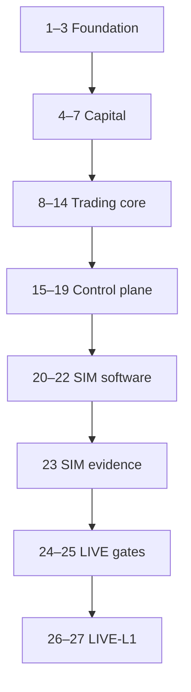

# SATE (Sata)

**Sovereign Autonomous Trading Ecosystem** — a private, owner-operated system for automated trading under limits you commit in advance and a compiled safety kernel enforces. This repository holds the authoritative requirements, the Group A engineering design, and (over time) the implementation.

**Owner:** Kennedy (sole operator and sole user). **Classification:** private — no credentials, broker logins, API keys, or bot tokens belong in this repo.

The Word sources in [`docs/source/`](docs/source/) are **normative**. The design in [`docs/design/group_a/`](docs/design/group_a/) is the day-to-day specification: a reader should be able to implement Group A from that package, and the sources win if the two conflict.

*The source documents define design intent, not financial or legal advice. Leveraged trading can lose more than deposited capital.*

---

## What SATE is for

SATE exists so one owner can run **two independent trading programs** with a single operating model:

- **Deterministic risk and execution.** Strategies propose *intents*. A **Rust kernel** returns a *verdict* before anything reaches a broker. There is no order without a valid verdict.
- **Signed limits.** A **Constitution** caps universe, sizing, drawdown, modes, and treasury rules. The kernel refuses unsigned, expired, or invalid configuration. There is no per-trade human approval workflow; the Constitution is the standing authority.
- **Full auditability.** An append-only, hash-chained **fact log** records orders, fills, halts, owner actions, and advisory inputs so every decision can be replayed and explained (`/why` in Telegram, journal in the web app).
- **Fail-closed safety.** Halt ladder (L1–L4), owner **kill switch** (K1–K3), broker-side **protective stops**, reconciliation against the broker as source of truth, and check-in / dead-man de-risking if the owner goes quiet.
- **Advisory AI, not autonomous AI.** A **cognitive plane** may publish signed advisory signals. It has **no** order, sizing, credential, or kernel authority. If advisory input is missing or invalid, the deterministic path uses a **zero view** and may abstain.

SATE is **not** a generic trading-bot framework. It is a complete operating model: capital accounting, ratified capital base (**RCB**), treasury and reimbursement, SIM-to-LIVE gates, runbooks, and a verification suite.

---

## Two groups, one ecosystem

Group A and Group B are **separate economic and execution domains**. They may share notification, reporting, and halt coordination, but **reporting may aggregate; control logic may not**. Combined balances and combined RCB are **reporting-only**. They must never drive sizing, risk limits, or LIVE eligibility for either group.

| | **Group A** | **Group B** |
|---|-------------|-------------|
| **Role** | Short-horizon leveraged engine (FX, metals, selected crypto CFDs) | Long-term unleveraged compounding (US equities and ETFs) |
| **Broker** | Exness via **MT5** (Windows host + bridge) | **Alpaca** (paper/live); IBKR planned as fallback |
| **Reference capital floor** | $500 RCB (necessary, never sufficient) | $200 RCB |
| **Modes** | SIM → **LIVE-L1 / L2 / L3** (+ MANAGE_ONLY, HALTED) | SIM → **LIVE-BMIN** / **LIVE-BFULL** |
| **Strategy sketch** | Kalman (+ regime), Black–Litterman with optional advisory; risk-budget sizing | **B-minimal** fixed-weight ETFs; **B-full** active allocation behind a validation gate |
| **Design status** | Full package under [`docs/design/group_a/`](docs/design/group_a/) | Source only; design package not started |

Each group has its own broker profile, capital ledger, RCB, Constitution, kernel, halt state, treasury ledger, and path to **LIVE eligibility**. Neither group needs the other to trade or to qualify for LIVE.

**Current build focus:** Group A first, on an [independent deployment](docs/design/group_a/independent-deployment-strategy.md) so Group A can run through SIM and LIVE while Group B is absent. The halt coordinator must never treat an unreachable Group B kernel as “everything is halted.”

---

## How a Group A trade is supposed to work

Path from the Group A system documentation (§6.1):

```
Market data → signals (deterministic + optional advisory) → Intent
  → KERNEL-A (halt, fingerprint, mode, RCB, risk, margin, stops, …)
  → Verdict (Allow | AllowWithSize | Reject | Throttle)
  → order manager → MT5 bridge → Exness
  → fills / reconciliation → fact log
```

Credentials stay inside the kernel. Telegram and the web app are **reduce-only** for fast stops (halt, flatten, kill, switch to SIM). Resume, SIM→LIVE, and loosening limits require the **web app** and **passkey** re-authentication.

---

## Safety and capital model (Group A)

| Mechanism | What it does |
|-----------|----------------|
| **RCB** | Ratified capital base. Limits use `min(RCB, equity)`. Increases need ratification and a cool-off; a deposit during a halt does not raise risk by itself. |
| **Five-state capital ledger** | Equity, realised PnL, settled, reserved, and withdrawable stay distinct. |
| **Protective stop** | Every entry needs a broker-side stop that still works if SATE is offline. |
| **Reconciliation** | Broker state is the source of truth. Mismatches block new risk before retry or resume. |
| **Halt ladder L1–L4** | Automatic de-risking from throttle through flatten, driven by kernel state. |
| **Kill K1–K3** | Owner-initiated stop from Telegram, web, or signed CLI. Telegram cannot resume. |
| **Check-in** | Kernel timer. Missed check-ins de-risk open exposure; away mode is explicit and time-bounded. |
| **Constitution** | Signed artifact. Time-lock on tighten/loosen. Pending changes do not activate silently. |

Open owner decisions (minimum lot vs risk cap, L2/L3 rungs, SIM return hurdle, time-lock hours, RPO/RTO, Kenya broker and tax verification, and others) are **implementation blockers**. Engineering does not invent those values. They are tracked in [`docs/design/group_a/decision-log.md`](docs/design/group_a/decision-log.md) and [`SOURCE-AMBIGUITIES.md`](docs/design/group_a/SOURCE-AMBIGUITIES.md).

---

## LIVE is not a feature flag

Going **LIVE** is allowed only when **that group alone** passes gates: capital and RCB, months of **SIM-adequacy** evidence, reconciliation history, written broker verification, signed Constitution and kernel, preflight with explicit reason codes, and drilled runbooks (Group A §19). Flipping an environment variable or a deploy flag is not sufficient.

Group A’s first live rung is **LIVE-L1** (narrow universe, ramp, shadow twin). Higher rungs stay disabled until the owner confirms them.

---

## Shared surfaces

| Surface | Purpose |
|---------|---------|
| **Web control plane** | Private SPA (passkey): Constitution, capital, eligibility, arming LIVE, resume, treasury, audit |
| **Telegram (`notifier-bot`)** | Always-with-owner notifications and **reduce-only** controls. Scope tags such as `[A-LIVE]`, `[A-SIM]`, `[ALL]`. Spec: [`docs/source/SATE_Telegram_Interface_Specification.docx`](docs/source/SATE_Telegram_Interface_Specification.docx); design: [`docs/design/group_a/telegram-interface.md`](docs/design/group_a/telegram-interface.md) |
| **Signed CLI** | Out-of-band kill if web and Telegram are unavailable |
| **Halt coordinator** | K1–K3 and ALL-scope halt with explicit partial confirmation |

---

## How the documentation is organised

Start at the project root (this file), then the Group A package index.

| If you need… | Read |
|--------------|------|
| What the whole system is | This README |
| Group A architecture and components | [`architecture-components.md`](docs/design/group_a/architecture-components.md) |
| How Group A runs without Group B | [`independent-deployment-strategy.md`](docs/design/group_a/independent-deployment-strategy.md) |
| Code tree (`group_a/`, `group_b/`, `shared/`) and CI path filters | [`repository-layout.md`](docs/design/group_a/repository-layout.md) |
| A subsystem in depth | Numbered files `01`–`15` and [`telegram-interface.md`](docs/design/group_a/telegram-interface.md) — index in [`docs/design/group_a/README.md`](docs/design/group_a/README.md) |
| What to build, in order | [`implementation-phases.md`](docs/design/group_a/implementation-phases.md) — **27** build-complete phases |
| Which requirement lands where | [`traceability-matrix.md`](docs/design/group_a/traceability-matrix.md) and [`requirements-index.md`](docs/design/group_a/requirements-index.md) (132 `A-*` IDs) |
| What is still undecided | [`decision-log.md`](docs/design/group_a/decision-log.md), [`SOURCE-AMBIGUITIES.md`](docs/design/group_a/SOURCE-AMBIGUITIES.md) |
| Whether a source section is covered | [`COVERAGE-CHECKLIST.md`](docs/design/group_a/COVERAGE-CHECKLIST.md) |

### Authoritative sources

| Document | Role |
|----------|------|
| [`docs/source/SATE_Group_A_System_Documentation.docx`](docs/source/SATE_Group_A_System_Documentation.docx) | Group A requirements, scenarios, verification, backlog, LIVE gates |
| [`docs/source/SATE_Group_B_System_Documentation.docx`](docs/source/SATE_Group_B_System_Documentation.docx) | Group B (future track; independence rules apply now) |
| [`docs/source/SATE_Telegram_Interface_Specification.docx`](docs/source/SATE_Telegram_Interface_Specification.docx) | Shared Telegram bot behaviour, tests, and backlog |

Document control on the sources: 16 October 2026; requirements and implementation definition for review.

### Group A design files (short index)

| Document | Subject |
|----------|---------|
| [`01-system-overview-independence.md`](docs/design/group_a/01-system-overview-independence.md) | Purpose, independence, principles, actors |
| [`02-capital-rcb-treasury.md`](docs/design/group_a/02-capital-rcb-treasury.md) | Capital, RCB, fees, treasury |
| [`03-modes-ladder-sim-gates.md`](docs/design/group_a/03-modes-ladder-sim-gates.md) | Modes, SIM→LIVE, ladder, SIM-adequacy |
| [`04-strategy-quant-engine.md`](docs/design/group_a/04-strategy-quant-engine.md) | Universe, signals, sizing, costs |
| [`05-kernel-oms-reconciliation.md`](docs/design/group_a/05-kernel-oms-reconciliation.md) | Kernel, OMS, reconciliation |
| [`06-broker-exness-mt5.md`](docs/design/group_a/06-broker-exness-mt5.md) | Exness MT5 adapter and verification |
| [`07-constitution-crypto-deployment.md`](docs/design/group_a/07-constitution-crypto-deployment.md) | Constitution and signed deploy |
| [`08-halts-kill-checkin.md`](docs/design/group_a/08-halts-kill-checkin.md) | Halts, kill, check-in |
| [`09-cognitive-plane.md`](docs/design/group_a/09-cognitive-plane.md) | Advisory signals |
| [`10-data-audit-fact-log.md`](docs/design/group_a/10-data-audit-fact-log.md) | Fact log and journal |
| [`11-web-control-api.md`](docs/design/group_a/11-web-control-api.md) | Web API and SPA |
| [`telegram-interface.md`](docs/design/group_a/telegram-interface.md) | Telegram integration |
| [`12-monitoring-backup-continuity.md`](docs/design/group_a/12-monitoring-backup-continuity.md) | Alerts, backup, restore |
| [`13-scenarios-runbooks.md`](docs/design/group_a/13-scenarios-runbooks.md) | Operational scenarios and runbooks |
| [`14-verification-risks-live-gates.md`](docs/design/group_a/14-verification-risks-live-gates.md) | Tests, risks, definition of done |
| [`15-persistent-schemas-constitution.md`](docs/design/group_a/15-persistent-schemas-constitution.md) | Entities and Constitution example |

---

## Delivery plan (Group A)

Implementation is **27 phases**. A phase is done only when its scope is built, integrated, verified, and documented. Phases are capability and evidence gates. They are not permission to go LIVE.

| Macro | Phases | Outcome |
|-------|--------|---------|
| **A** Foundation | 1–3 | Program, account identity, fact log |
| **B** Capital | 4–7 | Ledger, treasury, RCB, Constitution |
| **C** Trading core | 8–14 | Signed kernel, vault, MT5, OMS, reconciliation, stops |
| **D** Control | 15–19 | Halt/kill, check-in, web, Telegram, monitoring and host |
| **E** SIM software | 20–22 | Strategy, cognitive shadow, adequacy engine |
| **F** SIM calendar | 23 | At least six months of SIM evidence |
| **G** LIVE gates | 24–25 | Broker/tax evidence and §19 verification |
| **H** LIVE-L1 | 26–27 | First live session, ramp, steady LIVE-L1 |

Detail, backlog IDs, and exit criteria: [`docs/design/group_a/implementation-phases.md`](docs/design/group_a/implementation-phases.md).



---

## Identifier conventions

| Family | Meaning |
|--------|---------|
| `A-AREA-nn` | Group A requirement (for example `A-KRN-01`, `A-IND-03`) |
| `A-DEC-nn` | Owner decision that blocks implementation if left open |
| `A-P0/P1/P2-nn` | Backlog item from Group A §18 |
| `INV-nn` | Invariant that tests must enforce |
| `TG-nn`, `TG-S-nn`, `TG-T-nn`, `TG-PO-nn`, `SEC-nn` | Telegram requirements, scenarios, tests, backlog, security |
| `TS-`, `HL-`, `OC-`, `AM-`, `CT-`, `OP-`, `BF-`, `MP-` | Group A operational scenario families |

**Shall** in the source is mandatory. Design documents keep the same IDs so work stays traceable.

---

## Repository layout (application code)

When implementation starts, code lives in **three roots** (not mixed at repo top):

| Path | Role |
|------|------|
| [`group_a/`](docs/design/group_a/repository-layout.md) | KERNEL-A, strategy, cognitive, Exness MT5 — **no imports from `group_b/`** |
| [`group_b/`](docs/design/group_a/repository-layout.md) | KERNEL-B, Alpaca (future) — **no imports from `group_a/`** |
| [`shared/`](docs/design/group_a/repository-layout.md) | Fact log, capital/RCB/treasury (scoped), web, Telegram bot, halt coordinator — **no broker trade keys** |

CI/CD uses **path filters**: a deploy that only changes `group_b/` must not rebuild or restart Group A. Full tree, separation-of-concern rules, and workflow names: [`docs/design/group_a/repository-layout.md`](docs/design/group_a/repository-layout.md).

Design documents remain under [`docs/design/group_a/`](docs/design/group_a/) (and future `docs/design/group_b/`).

---

## Repository status

| Area | Status |
|------|--------|
| Group A and Telegram sources | In [`docs/source/`](docs/source/) |
| Group A design (subsystems, Telegram, 27 phases, traceability, **repo layout**) | In [`docs/design/group_a/`](docs/design/group_a/) |
| Group B design package | Not started |
| Application folders `group_a/`, `group_b/`, `shared/` | **Phase 13** reconciliation against broker truth |
| CI | Path-filtered workflows under [`.github/workflows/`](.github/workflows/) |

**Phase 13** is the current engineering baseline: reconciliation compares positions, orders, and balances with the broker and blocks new risk in the same step as a mismatch. The local book is corrected from the broker. A mismatch does not create a fill and does not allow an order retry until one later compare is clean. An unreadable broker keeps the last book. Terms that changed, and frozen withdrawals, block new risk without a new balance cap. The compare also runs on the five-second poll and on order, fill, and outage events. A retry waits until that compare is clean, and loading a new book waits for a fresh compare. The order manager, the demo bridge, the 24 hour staging run, the sub-millisecond latency target, and the MT5 terms check are unchanged. Five real demo sessions are not claimed. Lock hours are still the open placeholder, so LIVE stays closed. Open decisions stay in [decision-log.md](docs/design/group_a/decision-log.md). Layout decision: [ADR-0001](docs/design/group_a/adr/ADR-0001-repo-layout-and-independent-deploy.md).
