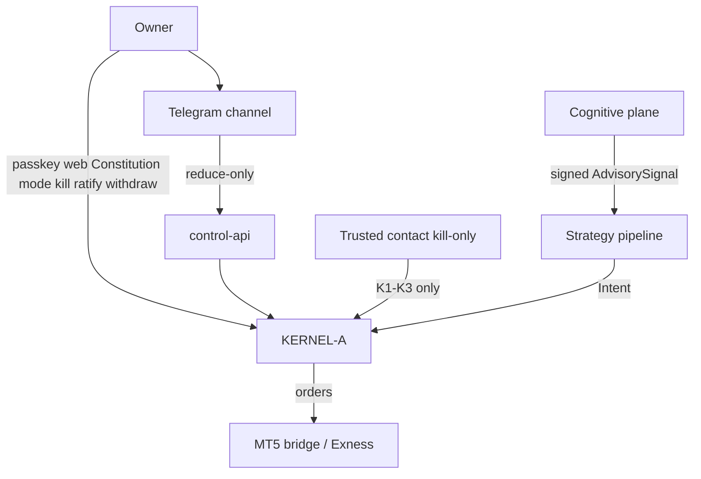

# System overview, principles, and independence

**Source:** Group A System Documentation §1–2 (`docs/source/SATE_Group_A_System_Documentation.docx`).

---

## 1. Purpose and scope (§1.1–1.2)

Group A is the **leveraged speculative engine** within SATE: G10 forex, gold, and selected crypto **CFDs** via **Exness MT5**, in **SIM** (demo) and **LIVE** (real) modes.

In scope for Group A (and this design package):

- Broker adapter + **MT5 bridge**, **KERNEL-A**, capital ledger, **RCB**, capital ladder, treasury ledger, halt state, performance record.
- Signals, sizing, execution, **broker-side protective stops**, reconciliation, reporting.
- Consumption of **shared services** (§2.6) under group-scoped contracts only.

Group B is referenced only for the **independence contract** (§1.3) and **ALL-scope halt** (§9.3).

Group A is a **complete economic and execution domain**: it does not depend on Group B to trade, size risk, or become LIVE-eligible.

---

## 2. Independence contract (§1.3)

**Rule:** Reporting may aggregate Group A and Group B; **control logic may not**.

### 2.1 Forbidden behaviours and enforcement

| Forbidden behaviour | Enforcement (design) | Verification |
|---------------------|----------------------|--------------|
| Group B capital satisfies Group A gate | API + kernel require `scope=A` capital source | Inject B capital into A gate → reject |
| Group A capital satisfies Group B gate | Same, scope B | Inject A capital into B gate → reject |
| Combined capital satisfies per-group gate | Combined values tagged `REPORTING_ONLY`; risk services reject | $500 A + $200 B must not satisfy $700 gate |
| Combined RCB used for sizing | Sizing API accepts exactly one group RCB context | Combined RCB injection → schema/API reject |
| Cross-group rescue via kernels | No transfer API; treasury = owner operation with evidence | Kernel-to-kernel rescue impossible |
| Cross-group LIVE eligibility | LIVE evaluated per group | B LIVE does not change A eligibility |
| Dashboard total in trading decision | Reporting projection separated from risk-service contract | Static/dataflow test: no combined field → sizing |

### 2.2 Requirements

| ID | Requirement (summary) |
|----|------------------------|
| **A-IND-01** | Capital records: `scope=A` (or GLOBAL if genuinely shared) + broker/account IDs |
| **A-IND-02** | Risk APIs: explicit group scope; reject GLOBAL or other group's capital |
| **A-IND-03** | Group A state transition never mutates Group B state |
| **A-IND-04** | Group A operates with own halts if B stopped; coupling = reporting + ALL halt protocol only |

**Design implication ([independent-deployment-strategy.md](./independent-deployment-strategy.md)):** Group B may be absent; halt coordinator must never infer `HALT_CONFIRMED_ALL` from B unreachable (**INV-06**).

---

## 3. Document conventions (§1.4)

- Requirements: **shall**, ID **`A-AREA-nn`**.
- **Starting value** → Constitution, tuned via validation.
- **IMPLEMENTATION BLOCKER — DECISION REQUIRED** → §20 / [decision-log.md](./decision-log.md); engineers shall not assume.
- Market times: **UTC** or **New York** (DST affects EAT-relative scheduling).
- Illustrative numbers: verify with broker before LIVE use.

---

## 4. Terminology (§1.5)

| Term | Meaning for Group A |
|------|---------------------|
| **SIM / LIVE** | Exness demo vs real account |
| **Intent** | Proposed order from deterministic pipeline; never sent to broker directly |
| **Verdict** | Kernel decision: Allow, AllowWithSize, Reject, Throttle |
| **Kernel** | Rust process: validates intents, holds trade credentials, owns halt state |
| **Constitution** | Signed configuration of all Group A limits |
| **RCB** | Ratified capital base; `rcb_equity_A` effective for limits |
| **Fact log** | Append-only hash-chained audit log |
| **MANAGE_ONLY** | Manage/reduce exposure; no new risk-increasing entries |
| **Protective stop** | Stop at broker; effective if SATE offline |
| **Reporting-only** | Display/aggregate only; never sizing, eligibility, or risk limits |
| **Owner** | Sole operator; pays vendors; performs broker withdrawals |

---

## 5. Role and objectives (§2.1–2.2)

**Role:** High-velocity short-horizon trading, **no overnight directional bias by default**, net-of-cost returns inside pre-committed limits enforced by compiled kernel.

**Objectives:**

1. Net-of-cost returns within pre-committed risk limits.
2. Kalman + advisory (Black–Litterman) when advisory valid; abstain when weak.
3. Leverage used far below broker max; risk-budget sizing.
4. Every entry with **broker-side stop**.
5. Owner visibility: what, why, on what information, if wrong.
6. Running costs proportionate to Group A capital.

---

## 6. System characteristics (§2.3)

| Aspect | Group A |
|--------|---------|
| Instruments | G10 FX, gold, selected crypto CFDs; Constitution-controlled; **LIVE-L1: EUR/USD only** (starting value) |
| Broker | Exness; **MT5 + Python bridge**; no native API assumed |
| Host | **Windows**; separate demo/live terminal instances |
| Leverage | Within Constitution; far below broker max; may change without notice |
| Signal | Kalman tick mode (innovation threshold **2.5σ** starting); BL with advisory |
| Sizing | Risk-budget, vol-aware, lot-step floor; reject if min lot > budget |
| Stops | Broker-side on every entry |
| Modes | Exness demo (SIM) / real (LIVE) |
| Reference floor | **$500** — necessary, never sufficient |
| State ladder | SIM, LIVE-L1/L2/L3, MANAGE_ONLY, HALTED |
| Costs | Spread, commission, swap (incl. Wed triple), slippage |
| Timing | Continuous **24×5**; FX week opens **Sunday 17:00 New York** |

---

## 7. Operating principles (§2.4)

| ID | Principle |
|----|-----------|
| **A-PR-01** | LLM advisory only; downstream numbers trace to tools or deterministic math |
| **A-PR-02** | Kernel only holder of trade-capable credentials |
| **A-PR-03** | Broker = source of truth; fact log records |
| **A-PR-04** | Abstention valid at every stage |
| **A-PR-05** | Risk down = fast/easy; risk up = slow + strong auth |
| **A-PR-06** | Model/parameter change via promotion gates only, not live path |
| **A-PR-07** | Only risk capital traded |
| **A-PR-08** | Journal before action; review after outcome |

---

## 8. Actors and authority (§2.5)

| Actor | Authority | Channels |
|-------|-----------|----------|
| **Owner** | Constitution, RCB ratification, mode, kill, check-in, re-arm, withdrawals | Web passkey, Telegram allowlist, signed CLI |
| **Telegram** | Read status; halt/flatten/kill; SIM switch; cancel arming; check-in; **never** increase exposure | Bot |
| **Trusted contact** | Kill-only K1–K3 if configured | Kill-only key |
| **KERNEL-A** | Final order decision; halt/kill state | Internal |
| **Cognitive plane** | Advisory signals only | Internal signed API |

---

## 9. Shared services (§2.6)

Shared services provide information, reporting, or coordination — **never execution authority**.

| Service | Group A use | Constraint |
|---------|-------------|------------|
| Cognitive plane | Signed advisory for A instruments | Failure → zero view |
| Fact log | Events with `group_scope=A` | Cannot approve trades |
| Market-data ingestion | Normalised ticks/bars + freshness | Stale → block new risk |
| Halt service | K1–K3; halt confirmation states | Cannot assert ALL if kernel unreachable |
| Web + Telegram | Scoped views/commands | Server-side scope |
| Monitoring | A-scoped metrics/alerts | CRITICAL never suppressed |
| Backup/restore | A state + evidence | Restore requires verification |
| Crypto authority | Sign/verify Constitution + kernel artifacts | Distinct keys per scope |
| Telegram bot | Notify + reduce-only control | See [telegram-interface.md](./telegram-interface.md) |

Full component wiring: [architecture-components.md](./architecture-components.md).

---

## 10. Non-negotiable capital rule (§3 callout)

Combined cash/equity may exist for **reporting** only. It must **not** enter Group A sizing, RCB, LIVE eligibility, treasury eligibility, or risk limits. Detail: [02-capital-rcb-treasury.md](./02-capital-rcb-treasury.md).
