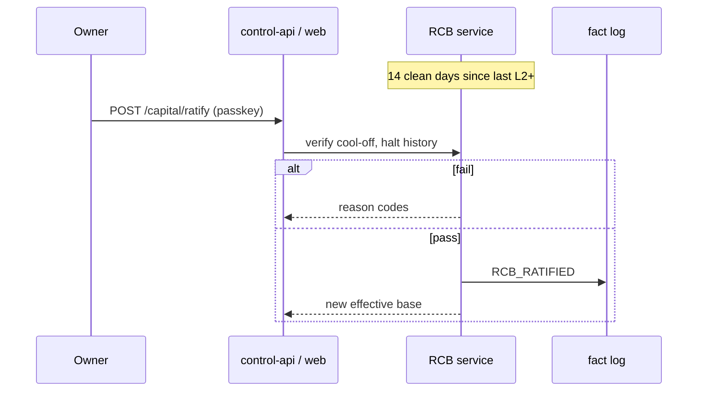

# Capital, RCB, fees, and treasury

**Source:** Group A §3, §10; scenarios §15.5 (CT-*); requirements **A-RCB-***, **A-FEE-***, **A-TRE-***, **A-OBL-***.

---

## 1. Capital hierarchy (§3.1)

```
broker-reported equity_A
  → realised_pnl_A
  → settled_cash_A
  → reserved_cash_A
  → withdrawable_cash_A

reimbursement_owed_A  (tracked separately; invoice ≠ cash)
```

**INV-04:** Equity is never treated as withdrawable cash.

---

## 2. Capital-state data model (§3.2)

| Field | Meaning | Source of truth | Must never be confused with |
|-------|---------|-----------------|------------------------------|
| `equity_A` | Broker equity at timestamp | Broker, reconciled → fact log | withdrawable/settled cash |
| `realised_pnl_A` | Crystallised trading P&L incl. fees | Broker ledger/fills | “current cash” alone |
| `settled_cash_A` | Settled eligible cash per verified rules | Broker settlement state | equity |
| `reserved_cash_A` | Reserved for floor, obligations, fees, buffers | Treasury + Constitution | available for withdrawal |
| `withdrawable_cash_A` | After broker rules + reserves | Treasury calculation | RCB or profit headline |
| `reimbursement_owed_A` | Owner-paid costs owed back to owner | Invoices + cost ledger | broker balance |
| `rcb_equity_A` | Effective risk capital from ratified base + equity | RCB service | treasury balance |
| `rcb_realised_A` | Realised-capital reference for obligation funding | RCB + treasury | unrealised equity |
| `cash_floor_A` | Minimum protected cash/reserve | Constitution + treasury | discretionary withdrawal amount |

All snapshots: **`group_id=A`**, broker/account identifiers (**A-IND-01**).

---

## 3. Reference thresholds (§3.3)

| Threshold | Meaning | LIVE effect |
|-----------|---------|-------------|
| **$500 Group A reference floor** | Level at which floor *may* be considered (subject to min lot, per-trade cap, SIM-adequacy) | Necessary, **never sufficient** |
| Below $500 | May be untradeable (min lot vs budget) | Reject `untradeable_at_this_capital`; reverse-graduation |
| **$1,500 combined** | Planning / bridge reference across systems | **Does not** gate Group A LIVE or sizing |
| Above LIVE-L1 | LIVE-L2/L3 capital levels | **A-DEC-02** — BLOCKED |

**Design note:** Reference floor unlocks *possibility* of LIVE; **SIM-adequacy** unlocks *right* to LIVE. Deposits to reach floor are **inert** until ratified (§3.4).

---

## 4. Ratified capital base — RCB (§3.4)

| ID | Rule |
|----|------|
| **A-RCB-01** | Limits on effective RCB (ratified base constrained by equity) |
| **A-RCB-02** | Equity below RCB → limits fall immediately to permitted level |
| **A-RCB-03** | Withdrawal reduces RCB at once; treasury models capacity before authorising reimbursement |
| **A-RCB-04** | RCB increase (deposit/injection/profit) effective only after **14 consecutive days** no L2/L3/L4 + passkey ratification |
| **A-RCB-05** | L2/L3/L4 restarts 14-day cool-off |
| **A-RCB-06** | Deposit during/after halt inert for limit expansion; injections pause on L2+ |
| **A-RCB-07** | No ratification → continue on existing base |
| **A-RCB-08** | No pooling A/B; service cannot ratify alone |

**INV-09:** RCB increases cannot bypass cool-off and ratification.

### 4.1 Ratification flow (design)



---

## 5. Fees, currency, obligations (§3.5)

| ID | Requirement |
|----|-------------|
| **A-FEE-01** | Trading costs (fees, swap, slippage) not silently absorbed as infra drag |
| **A-FEE-02** | Withdrawal/FX costs in treasury ledger + cost model |
| **A-FEE-03** | Obligations: owner, due date, currency, amount, broker dependency, reserve flag |
| **A-FEE-04** | Group A obligation from Group A liquidity only; if cash at B → **cross-broker owner transfer** flag, not B balance as A cash |
| **A-FEE-05** | Reporting currency: FX rate **at each fill**; broker statements authoritative |

---

## 6. Treasury principles (§10.1)

- Trading accounts are **not** vendor payment accounts.
- Owner pays vendors and performs **all broker withdrawals**.
- Invoices = evidence for reimbursement scheduling; they **do not** create broker cash or authorise withdrawal.

---

## 7. Cost tagging and allocation (§10.2)

| ID | Rule |
|----|------|
| **A-TRE-01** | Tag every cost: **A**, **B**, or **GLOBAL** |
| **A-TRE-02** | A-native costs → A directly; shared costs → allocation events (basis, rule version, evidence). Starting basis: **pro-rata by RCB**, monthly review (**A-DEC-05**) |
| **A-TRE-03** | Allocation lien = treasury obligation; **not** inter-group transfer; cannot change either RCB |
| **A-TRE-04** | A cannot reimburse → must not consume B capital |
| **A-TRE-05** | Infra tier cap; metered hard-stop; cap breach → NOTICE, disable optional components first |
| **A-TRE-06** | Owner bridge (~**$60/mo** combined) recorded as owner-paid; not P&L; not RCB/eligibility (**A-DEC-06**) |

---

## 8. Reimbursement state machine (§10.3)

```
COST_RECORDED
  → REIMBURSEMENT_ELIGIBILITY_PENDING
  → REIMBURSEMENT_AUTHORIZED
  → WITHDRAWAL_PENDING_OWNER
  → OWNER_CONFIRMED
  → BROKER_RECONCILIATION
  → REIMBURSED | MISSED/FAILED
```

**Eligibility check (design):**

```
settled_cash_A - reserved_cash_A - cash_floor_A - pending_obligations - withdrawal_fees - FX
  >= proposed_reimbursement
```

**INV-05:** Reimbursement not complete until **reconciled broker movement**. Never emit withdrawal-success on authorisation alone.

| State | System | Owner |
|-------|--------|-------|
| COST_RECORDED | Record invoice/allocation | Review optional |
| REIMBURSEMENT_ELIGIBILITY_PENDING | Check cash/floors/obligations | — |
| REIMBURSEMENT_AUTHORIZED | Instruction + Telegram NOTICE | Approve |
| WITHDRAWAL_PENDING_OWNER | Wait; no false success | Withdraw in broker portal |
| OWNER_CONFIRMED | Capture confirmation | Confirm in web |
| BROKER_RECONCILIATION | Match statement | If discrepancy |
| REIMBURSED | Close owed amount | — |
| MISSED/FAILED | Preserve debt/reserves; escalate | Resolve |

Telegram templates: [telegram-interface.md](./telegram-interface.md) §6.9.

---

## 9. Obligations and shortfalls (§10.4)

| ID | Rule |
|----|------|
| **A-OBL-01** | Reduce exposure before obligation due; kernel blocks new risk if cash floor at risk |
| **A-OBL-02** | Cross-broker transfer = owner action + slow path + look-ahead procedure |
| **A-OBL-03** | Insufficient withdrawable cash → defer reimbursement, preserve buffer |

---

## 10. Manual withdrawal procedure (§10.5)

1. Treasury computes amount/due date → **Telegram TREASURY NOTICE** (broker, amount, date).
2. System reduces exposure (Group A: **free margin**).
3. Owner withdraws in **Exness portal** (no programmatic withdrawal assumed).
4. Owner confirms in web → kernel reconciles → **lowers RCB**.
5. Missed deadline → remind; keep buffer reserved.
6. Quarterly: small test withdrawal to Kenyan bank/M-Pesa; record fees/delay.

Runbook: [13-scenarios-runbooks.md](./13-scenarios-runbooks.md) Appendix C.8.

---

## 11. Scenario mapping (§15.5)

| ID | Trigger (summary) | Design touchpoints |
|----|-------------------|-------------------|
| CT-01 | Deposit | RCB ratification after 14 clean days |
| CT-02 | Deposit during halt | Inert; cool-off restart |
| CT-03 | Profit above RCB | Limits on RCB until ratified |
| CT-04 | Equity below RCB | Limits shrink immediately |
| CT-05 | Withdrawal/reimbursement | §10.3 machine + manual portal |
| CT-06 | Missed deadline | MISSED/FAILED |
| CT-07 | Obligation at A, cash at B | A-OBL-02 flag only |
| CT-08 | Infra/LLM cap | A-TRE-05; advisory zero |
| CT-A1 | Deposit above floor | Floor test uses **RCB**, not raw equity |

---

## 12. Integration points

| Consumer | Uses capital data | Forbidden use |
|----------|-------------------|---------------|
| KERNEL-A checks §6.4 | min(RCB, equity), drawdown, margin | Combined A+B |
| Sizing §5.3 | `capital_base = min(ratified_base, equity)` | Dashboard total |
| LIVE preflight §4.3 | RCB ≥ floor, treasury floors | Raw equity alone |
| Web Capital page §13.3 | All fields labelled by type | Single “balance” |
| Telegram /treasury | Obligations, reimbursement states | Masking via /mask |
