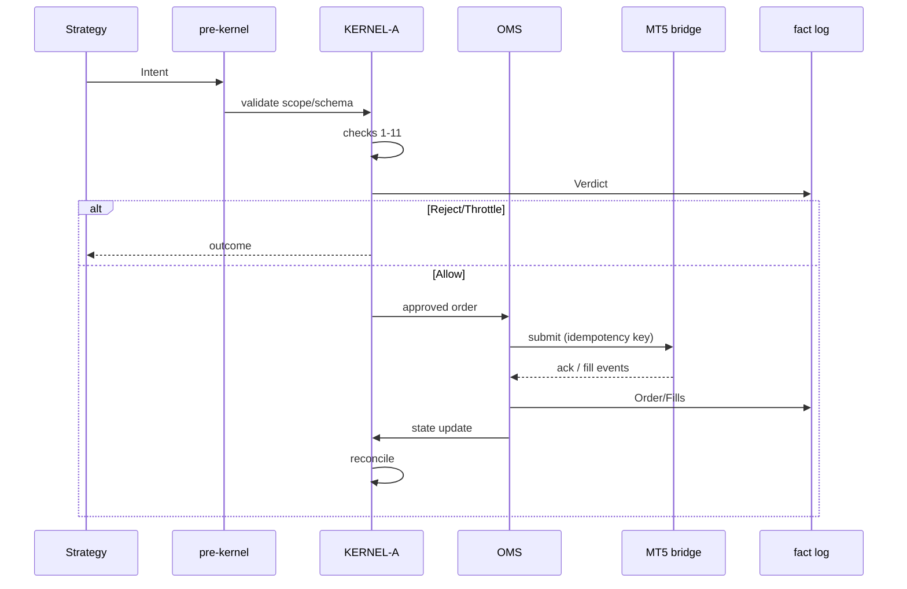

# Trading engine, kernel, OMS, and reconciliation

**Source:** Group A §6; **A-KRN-***, **A-OMS-***, **A-REC-***; Appendix B schemas.

---

## 1. Control path (§6.1)

See [architecture-components.md](./architecture-components.md) for deployment binding. Logical path:

1. Market data validation (freshness).
2. Strategy → **Intent** (§6.2).
3. Group-scoped pre-kernel validation.
4. **KERNEL-A** checks (§6.4 order).
5. **Verdict** → OMS → MT5 bridge (ZeroMQ) → terminal → Exness.
6. Fills/positions/cash → fact log + reconciliation.

**INV-01:** No broker order without valid kernel verdict.

---

## 2. Intent schema (§6.2, Appendix B)

| Field | Requirement |
|-------|-------------|
| `intent_id` | Globally unique, idempotent; includes group scope |
| `group_id` | **Mandatory A** — never from combined dashboard |
| `instrument` | In Constitution universe for **current rung/state** |
| `side`, `quantity`, `order_type` | Schema validated pre-kernel |
| `risk_inputs` | Each numeric value has deterministic provenance ref |
| `strategy_id`, `model_version` | Replay/attribution |
| `advisory_refs` | Optional; absence valid |
| `account_profile` | Explicit SIM/LIVE; fingerprint checked in kernel |

**ExecutionIntent** (Appendix B): adds `trace_id`, `protective_stop`, `take_profit`, `slippage_budget`, `signal_refs`, `created_at`.

---

## 3. Kernel responsibilities (§6.3)

| ID | Requirement | Design note |
|----|-------------|-------------|
| **A-KRN-01** | Validate every intent before broker; kernel down → no orders | Fail closed |
| **A-KRN-02** | Hold trade credentials; submit/sign orders; execution nodes hold none | Keys trade-only, IP-restricted |
| **A-KRN-03** | Poll broker read-only **every 5s**; fills update state immediately; poll fail → safe mode | Reconciliation backstop |
| **A-KRN-04** | Protective orders on every entry | Adapter verifies before open |
| **A-KRN-05** | Own halt/kill; persist disk; restore on restart | HL-D recovery |
| **A-KRN-06** | Kill/halt read **before** any other check | Check order #1 |
| **A-KRN-07** | p99 verdict latency **<1ms**; no heap alloc on hot path | Separate process; local socket/pipe |
| **A-KRN-08** | Failing check short-circuits risk-increasing; risk-reducing where permitted | HALTED may still flatten |

---

## 4. Check order (§6.4)

| # | Check | Notes |
|---|-------|-------|
| 1 | Kill and halt state | Reject risk-increasing if set |
| 2 | Account fingerprint | HL-C on mismatch |
| 3 | Mode/state/rung universe/ramp | A-MOD-*, A-UNI-01 |
| 4 | RCB and ratified limits | min(RCB, equity) |
| 5 | Drawdown | Daily + peak |
| 6 | Per-trade risk budget | Min lot rule |
| 7 | Open notional + leverage used | Constitution |
| 8 | Concentration | Per-instrument + correlated |
| 9 | Margin level | After hypothetical order |
| 10 | News blackout + swap-cost guard | A-EXE-02 |
| 11 | Rate limit | Throttle verdict |

**Verdict types:** Allow | AllowWithSize(q) | Reject(reason) | Throttle.

**Verdict record:** checks executed with value/limit/pass; `kernel_version`, `constitution_version`, `halt_level`, `kill_state`, `latency_us`, `issued_at`.

---

## 5. OMS and idempotency (§6.5)

| ID | Rule |
|----|------|
| **A-OMS-01** | Deterministic client + correlation ID on every submission |
| **A-OMS-02** | No retry on local timeout alone; query broker + reconcile first |
| **A-OMS-03** | Partial fill → explicit event; remainder = new state |
| **A-OMS-04** | Idempotent cancellation |
| **A-OMS-05** | Duplicate intent → existing outcome, no duplicate order |

---

## 6. Reconciliation (§6.6)

| ID | Rule |
|----|------|
| **A-REC-01** | Event-driven + daily + around orders/fills/outages; 5s poll for equity/margin/positions |
| **A-REC-02** | Broker source of truth; fact log stores observation + result |
| **A-REC-03** | Discrepancy = field-level diff; escalate; **ambiguous ≠ clean** |
| **A-REC-04** | May correct projections; cannot manufacture fills or grant trade permission |

Mismatch → **L2** (HL-B); no blind retry.

---

## 7. Failure behaviour (§6.7)

| Failure | Behaviour |
|---------|-----------|
| Stale market data | No new risk-increasing intents; log freshness failure |
| Broker unavailable | No blind retries; preserve state; degraded/halt adapter state |
| Kernel unavailable | No live order path; **broker stops** remain |
| Reconciliation mismatch | Restrict/halt by severity; resolve before normal flow |
| Wrong fingerprint | Immediate halt; no orders |
| Unknown broker rule | Block capability; never default permissive LIVE |
| Duplicate intent | Idempotency returns prior outcome |
| MT5 crash / bridge disconnect | Watchdog restart; pause until reconciled (BF-A1) |
| Feed degraded | L1 widen/reduce; severe → L2 |

---

## 8. Sequence: intent to fill

---

## 9. Red-team and performance tests (§16)

| Test | Pass condition |
|------|----------------|
| Kernel bypass | Blocked + logged (RT) |
| Wrong account | Fingerprint halt (16.2) |
| Oversized order | Reject |
| Clock skew | Logged; checks use broker time |
| Duplicate intent | Single broker order |
| MT5 disconnect mid-order | No duplicate; reconcile before resume |
| p99 latency | <1ms or documented blocker (PERF) |
