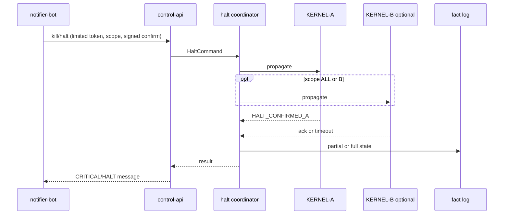

# Halts, kill switch, global halt protocol, and owner presence

**Source:** Group A §9; **A-KIL-***, **A-CHK-***; scenarios §15.2–15.3, §15.6; Telegram §6.5–6.6, §6.10.

---

## 1. Automatic halt ladder (§9.1)

| Level | Triggers | Behaviour | Exit |
|-------|----------|-----------|------|
| **L1 Throttle** | Slippage > budget (20-trade window); feed degraded | Size ×0.5; wider signal thresholds | Auto after N sessions recovery |
| **L2 Pause** | Daily loss limit; recon mismatch; fingerprint mismatch; kernel/feed heartbeat lost | Block new risk; manage existing | Next session after clean recon |
| **L3 Flatten** | Drawdown breach; margin stress; repeated L2 | Flat/hedge then stop | Terminal — owner re-arm |
| **L4 Dead-man** | Ops heartbeat absent; unexplained account change | Flatten + revoke kernel trading access | Terminal — re-provision credentials |

After L3/L4: **not same-day resume**; pre-mortem; Constitution tighten; web re-arm + ramp (C.5).

---

## 2. Owner kill switch (§9.2)

| Command | Group A effect | Typical use |
|---------|----------------|-------------|
| **K1** | No new entries; manage with stops/exits | Investigate conditions |
| **K2** | Cancel pending; close all at market/best; stop | Fast exit to cash |
| **K3** | K2 + seal credentials; stop execution processes | Compromise / runaway |

### 2.1 Channels and authentication

| Channel | Auth | Notes |
|---------|------|-------|
| Telegram halt/flatten/kill | Allowlist chat+user; confirm button **names scope**; K3 **double confirm** (30s / 60s) | [telegram-interface.md](./telegram-interface.md) |
| Web Controls | Passkey + confirm dialog | §13.3 |
| Signed CLI | Ed25519 to kernel local channel | Works if web/TG down |
| Trusted contact | Kill-only key K1–K3 | No resume/mode/limits |
| Broker portal | Manual | Documented fallback |

| ID | Rule |
|----|------|
| **A-KIL-01** | Kill works with cognitive plane, dashboard, notifier down — kernel + control channel + broker only |
| **A-KIL-02** | Halt/flatten/kill/LIVE→SIM on Telegram; resume/SIM→LIVE/loosen → web passkey only |
| **A-KIL-03** | Resume after K1/K2: web re-arm, cool-off (~15m example), clean recon, preflight; K3: re-provision + SIM→LIVE |
| **A-KIL-04** | Default scope **A**; ALL explicit in confirmation |
| **A-KIL-05** | Every kill → fact log: channel, identity, scope, positions |
| **A-KIL-06** | Each phase gate: drill K1–K3 all channels in SIM |

---

## 3. Global halt invariant (§9.3)

> Kernel unreachable ≠ kernel halted.  
> **HALT_CONFIRMED_ALL** only when both kernels confirm **or** broker emergency control renders unreachable account non-tradable.

| State | Meaning |
|-------|---------|
| HALT_REQUESTED | Command issued; acks pending |
| HALT_CONFIRMED_A | Group A kernel confirmed |
| HALT_CONFIRMED_B | Group B kernel confirmed |
| HALT_CONFIRMED_ALL | Both confirmed or approved external control |

**Protocol (design):**

1. Global `halt_command_id`.
2. Log issuer, scope, reason, time, auth evidence.
3. Propagate to each kernel in scope independently.
4. Record each ack.
5. Timeout policy — **missing ack ≠ success**.
6. Expose partial state in web + Telegram (**TG-15**, TG-S-16).
7. Escalate unresolved to owner + emergency runbook.
8. Recovery requires recon + re-arm.

**INV-06:** Unreachable kernel never becomes ALL confirmed.

---

## 4. Owner check-in dead-man (§9.4)

Applies while Group A **LIVE**; SIM continues during lapse (OP-05).

| Days | State | Behaviour |
|------|-------|-----------|
| 7 | Reminder | Telegram + email daily |
| 10 | MANAGE_ONLY | No new risk |
| 14 | Flatten | Close LIVE positions; stop |

| ID | Rule |
|----|------|
| **A-CHK-01** | Check-in = passkey web login or `/alive`; `/alive` not strong identity; never risk-increasing |
| **A-CHK-02** | Away mode extends timers up to Constitution max (**30d** starting; OI-TG-02 shorter max under review); strong auth in web |
| **A-CHK-03** | Timer in **kernel**; email independent of Telegram |
| **A-CHK-04** | Trusted contact ≠ operator; kill-only when owner unreachable and system not already acted |
| **A-CHK-05** | Day 10/14 affects leveraged positions (stops/exits or flatten) |

---

## 5. Integration: halt service ↔ control-api ↔ Telegram

---

## 6. Scenario cross-reference

| Family | IDs | Doc |
|--------|-----|-----|
| Automatic halts | HL-01, HL-02, HL-07, HL-08, HL-A–F | [13-scenarios-runbooks.md](./13-scenarios-runbooks.md) |
| Owner controls | OC-01–OC-08 | same |
| Owner presence | OP-01–OP-06 | same |
| Telegram | TG-S-05–10, TG-S-12–16 | [telegram-interface.md](./telegram-interface.md) |

Runbooks C.1–C.6: [13-scenarios-runbooks.md](./13-scenarios-runbooks.md).
