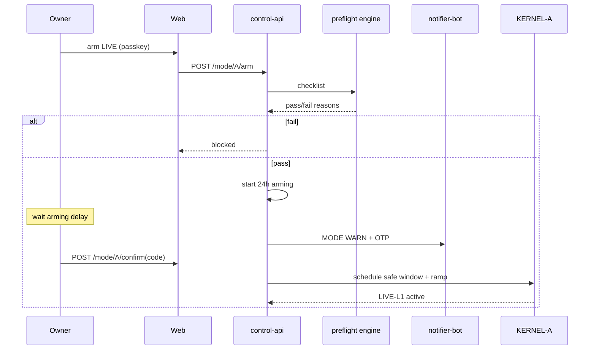

# Web control plane and API

**Source:** Group A §13.1–13.3; cross-ref Telegram [telegram-interface.md](./telegram-interface.md), kill §9.2.

---

## 1. Scope model (§13.1)

| Scope | Read | Risk-reducing | Risk-increasing |
|-------|------|---------------|-----------------|
| **A** | Group A state/records | A halt, reduce, flatten | Passkey + confirmation flow |
| **B** | B records (read-only in A doc context) | Via B system | Via B system |
| **ALL** | Combined reporting + global halt state | Global halt/kill via authorised flow | **Never** shortcut sizing/eligibility |

**API is the security boundary** — UI not trusted for scope (§13.2).

---

## 2. control-api endpoints (§13.2)

| Endpoint | Requirement |
|----------|-------------|
| `GET /state` | Per-group mode, halt, heartbeat, fingerprint, capital states, attention flags |
| `POST /kill` | Scope A \| B \| ALL; auth + confirmation; risk-reducing |
| `POST /mode/A/sim` | Explicit A; cannot change B |
| `POST /mode/A/arm` | Passkey re-auth; preflight; arming state |
| `POST /mode/A/confirm` | OTP delivered by Telegram; entered **in web only** |
| `POST /resume/A` | Clean recon, cool-off, authorisation |
| `POST /checkin` | Presence only |
| `POST /checkin/away` | Strong auth; bounded by away max |
| `POST /capital/ratify` | Scope A; passkey; verify 14-day clean |

Extend with read APIs for dashboard: positions, journal, eligibility, treasury — all **scope-parameterised**.

**Forbidden pattern:** any endpoint accepting `scope=GLOBAL` for risk-bearing operations (**A-IND-02**).

---

## 3. Web application (§13.3)

**Stack:** React + TypeScript SPA on **private network** (WireGuard/Tailscale).

**Security:** WebAuthn passkeys; short sessions; **fresh auth** for control actions; strict CSP; CSRF on control POSTs; rate limiting.

**Layout:** Group A and Group B **first-class separate views**. Combined view = separate reporting layer with label:

> Combined reporting — not transferable and not used for sizing or eligibility

### 3.1 Pages and Group A content

| Page | Group A content |
|------|-----------------|
| **Overview** | Capital hierarchy (not one ambiguous balance); activity; opportunities w/ evidence; risks; attention flag |
| **Capital** | equity, realised P&L, settled, reserved, withdrawable, reimbursement owed, RCB, ratification — **each labelled** |
| **Positions & orders** | Stops, pending, fills, slippage vs budget |
| **Performance** | Net-of-cost, attribution, drawdown, benchmark; **SIM/LIVE separate** |
| **Eligibility** | LIVE gates with **reason codes** |
| **Risk** | Exposure, margin, halt/kill, distance to limits, **partial halt** display |
| **Journal & Why** | Decisions; figures link to fact log; Why text from log only |
| **Treasury** | Cash floor, obligations, reimbursement states, withdrawal requests |
| **Controls** | Kill, mode arming/preflight, resume, ratify, check-in, away |
| **Constitution** | Read-only active + pending + time-lock countdown |
| **System health** | Process/broker health, hash-chain verify, replay, notification history |

Mode badge: **LIVE red**, **SIM blue** (**A-MOD-04**).

---

## 4. Asymmetry vs Telegram (§13.4, A-KIL-02)

| Action | Web | Telegram |
|--------|-----|------------|
| Arm LIVE, confirm OTP entry, resume, ratify, away completion | Yes (passkey) | No — link to web |
| Halt, flatten, kill, mode→SIM, cancel arming | Yes | Yes (reduce-only) |
| `/alive` check-in | Yes (passkey login) | Yes (weak presence) |

Group A **A-TG-01–06** align with Telegram spec **TG-01–16** — satisfy union of both.

---

## 5. dashboard-api (optional split)

Read-heavy aggregations for SPA. Must not expose combined fields on kernel/risk internal APIs. Reporting queries tagged `REPORTING_ONLY`.

---

## 6. Sequence: arm LIVE

