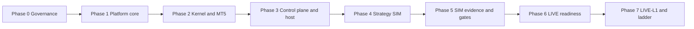

# Group A — Implementation Design Package

For **what SATE is as a whole** (both groups, shared control plane, LIVE gates, and repo layout), see the project [README.md](../../../README.md).

This folder holds **engineering design** for building and operating **Group A** through to **LIVE eligibility** and sustained **LIVE-L1** operation. It is derived from and must stay consistent with the authoritative requirements in `docs/source/`.

## Authoritative sources

| Document | Path | Role |
|----------|------|------|
| Group A System Documentation | [`docs/source/SATE_Group_A_System_Documentation.docx`](../../source/SATE_Group_A_System_Documentation.docx) | Requirements, behaviour, scenarios, verification, backlog (§1–20, Appendices A–D) |
| Telegram Interface Specification | [`docs/source/SATE_Telegram_Interface_Specification.docx`](../../source/SATE_Telegram_Interface_Specification.docx) | Shared `notifier-bot`, TG-/TG-S-/TG-T-/TG-PO- families (§0–18) |
| Group B System Documentation | [`docs/source/SATE_Group_B_System_Documentation.docx`](../../source/SATE_Group_B_System_Documentation.docx) | **Reference only** for independence contract (§1.3) and ALL-scope halt (§9.3); Group B is not in scope for initial delivery |

**Document control (from source):** Status — requirements and implementation definition, for review; Date — 16 October 2026; Owner — Kennedy (sole operator and user); Classification — private, no credentials in repo.

## Design documents in this folder

| File | Purpose |
|------|---------|
| [independent-deployment-strategy.md](./independent-deployment-strategy.md) | How Group A is deployed and operated **without depending on Group B** for trading, sizing, or LIVE gates |
| [implementation-phases.md](./implementation-phases.md) | End-to-end **implementation phases** from foundation through LIVE-L1, with deliverables, gates, tests, and traceability |
| [traceability-matrix.md](./traceability-matrix.md) | Requirement IDs, backlog items, scenarios, and verification classes mapped to phases |
| [architecture-components.md](./architecture-components.md) | Logical components, data flows, and authority boundaries (maps to Group A §2.6, §6.1, §13) |

## Phase map (summary)

Phases are **capability and evidence gates**, not permission to go LIVE. LIVE remains a **constitution of gates** (Group A §19), not a feature flag.

| Phase | Name | Primary source sections | Exit criterion (short) |
|-------|------|-------------------------|-------------------------|
| 0 | Governance and traceability | §1.4, §18 step 1, §20 | Requirement IDs, decision log, architecture signed off |
| 1 | Platform core (P0 foundation) | §3, §12, §8 (partial), A-P0-01–07 | Fact log, capital ledger, RCB, Constitution crypto |
| 2 | Kernel, OMS, Exness MT5 | §6, §7, A-P0-08–13 | Every intent → verdict → broker; reconciliation |
| 3 | Halt/kill, web/Telegram, Windows host | §9, §13, §14, Telegram spec | Reduce-only control; monitoring; A-DEC-07 resolved |
| 4 | Strategy and cognitive (SIM) | §5, §11 | Deterministic pipeline + advisory zero default |
| 5 | SIM operations and adequacy | §4.5, A-P1-01, §15 | Six-month evidence path running; gate engine |
| 6 | LIVE readiness | §4.3–4.4, §19, A-P1-06, Appendix D | Preflight, red-team, broker/tax verification |
| 7 | LIVE-L1 entry and operation | §4.1, §4.5 ladder, A-P1-02–03 | Ramped LIVE; shadow twin; L2/L3 blocked on A-DEC-02 |

## Independence (non-negotiable)

From Group A **§1.3** and **§3** (capital hierarchy callout):

- Group A and Group B are separate economic and execution domains.
- Reporting may aggregate; **control logic may not**.
- Combined cash/equity is **REPORTING_ONLY** — it must not enter sizing, RCB, LIVE eligibility, or risk limits (**A-IND-01–04**, **INV-02**, **INV-03**).

Initial delivery follows [independent-deployment-strategy.md](./independent-deployment-strategy.md): Group B may be **absent** as a trading system, but shared services must still **enforce scope A** and never infer Group B capital.

## Open decisions (implementation blockers)

Engineering must not silently resolve items listed in Group A **§20**. Track status in [decision-log.md](./decision-log.md). Blockers include **A-DEC-01** (minimum lot vs per-trade cap at floor), **A-DEC-02** (L2/L3 rungs), **A-DEC-03** (SIM return hurdle), **A-DEC-07** (Windows hosting), **A-DEC-08** (emergency relay), **A-DEC-09** (RPO/RTO), **A-DEC-10** (broker/tax).

## Conventions

- Requirements in source use **shall** and IDs **`A-AREA-nn`**.
- Telegram requirements use **`TG-nn`**, scenarios **`TG-S-nn`**, tests **`TG-T-nn`**, backlog **`TG-PO-nn`** (Telegram spec §11–15).
- Backlog items **`A-P0-nn`**, **`A-P1-nn`**, **`A-P2-nn`** (Group A §18).
- Scenarios **`TS-nn`**, **`HL-nn`**, **`OC-nn`**, **`AM-nn`**, **`CT-nn`**, **`OP-nn`**, **`BF-nn`**, **`MP-nn`** (Group A §15).
