# Group A — Implementation Design Package

For **what SATE is as a whole**, see the project [README.md](../../../README.md).

This folder is the **engineering design specification** for Group A: derived from and constrained by the authoritative Word sources in [`docs/source/`](../../source/). It is intended to be read **without opening the source documents** for day-to-day implementation, while the sources remain normative for conflicts.

**Sources (normative):**

| Document | Path |
|----------|------|
| Group A System Documentation | [`SATE_Group_A_System_Documentation.docx`](../../source/SATE_Group_A_System_Documentation.docx) |
| Telegram Interface Specification | [`SATE_Telegram_Interface_Specification.docx`](../../source/SATE_Telegram_Interface_Specification.docx) |
| Group B (reference only) | Independence §1.3, ALL-scope halt §9.3 |

**Document control (from source):** 16 October 2026; requirements/implementation definition for review; owner Kennedy; private — no credentials in repo.

---

## How to use this package

1. Start with [01-system-overview-independence.md](./01-system-overview-independence.md), [repository-layout.md](./repository-layout.md) (code tree + CI), and [architecture-components.md](./architecture-components.md).
2. Implement by subsystem using the numbered **`01`–`15`** design files below.
3. Track phases via [implementation-phases.md](./implementation-phases.md) and [traceability-matrix.md](./traceability-matrix.md).
4. Record owner decisions in [decision-log.md](./decision-log.md); ambiguities in [SOURCE-AMBIGUITIES.md](./SOURCE-AMBIGUITIES.md).
5. Verify coverage with [COVERAGE-CHECKLIST.md](./COVERAGE-CHECKLIST.md).

---

## Design document index

### Core architecture and deployment

| Document | Content (maps to GA §) |
|----------|-------------------------|
| [01-system-overview-independence.md](./01-system-overview-independence.md) | §1–2: purpose, independence, principles, actors, shared services |
| [architecture-components.md](./architecture-components.md) | Component catalogue, control path, kernel checks, interfaces summary |
| [repository-layout.md](./repository-layout.md) | `group_a/` / `group_b/` / `shared/` tree, separation of concerns, path-scoped CI/CD |
| [independent-deployment-strategy.md](./independent-deployment-strategy.md) | A-only topology, hosts, network, rollout |
| [adr/ADR-0001-repo-layout-and-independent-deploy.md](./adr/ADR-0001-repo-layout-and-independent-deploy.md) | Accepted layout and path-scoped deploy |
| [threat-model-v1.md](./threat-model-v1.md) | Phase 1 threat seed |
| [secret-management.md](./secret-management.md) | Where secrets may exist at runtime |

### Subsystems (detailed design)

| Document | Content (maps to GA §) |
|----------|-------------------------|
| [02-capital-rcb-treasury.md](./02-capital-rcb-treasury.md) | §3, §10: capital model, RCB, fees, treasury, reimbursement |
| [03-modes-ladder-sim-gates.md](./03-modes-ladder-sim-gates.md) | §4: modes, SIM→LIVE, ladder, SIM-adequacy, floor rules |
| [04-strategy-quant-engine.md](./04-strategy-quant-engine.md) | §5: universe, signals, sizing, costs, promotion |
| [05-kernel-oms-reconciliation.md](./05-kernel-oms-reconciliation.md) | §6: kernel, OMS, reconciliation, failures |
| [06-broker-exness-mt5.md](./06-broker-exness-mt5.md) | §7: adapter contract, MT5 bridge, verification |
| [07-constitution-crypto-deployment.md](./07-constitution-crypto-deployment.md) | §8: Constitution lifecycle, build/deploy pipeline |
| [08-halts-kill-checkin.md](./08-halts-kill-checkin.md) | §9: halt ladder, kill, global halt, check-in |
| [09-cognitive-plane.md](./09-cognitive-plane.md) | §11: AdvisorySignal, BL mapping, gates |
| [10-data-audit-fact-log.md](./10-data-audit-fact-log.md) | §12: fact log, journal, retention |
| [11-web-control-api.md](./11-web-control-api.md) | §13.1–13.3: API, SPA pages, LIVE arming |
| [telegram-interface.md](./telegram-interface.md) | Telegram spec §0–18 + GA §13.4 (**A-TG-***) |
| [12-monitoring-backup-continuity.md](./12-monitoring-backup-continuity.md) | §14: alerts, backup, DR drills |
| [13-scenarios-runbooks.md](./13-scenarios-runbooks.md) | §15 + Appendix C: all scenario IDs + runbooks |
| [14-verification-risks-live-gates.md](./14-verification-risks-live-gates.md) | §16–19, §17–18 backlog: tests, risks, LIVE gates |
| [15-persistent-schemas-constitution.md](./15-persistent-schemas-constitution.md) | Appendix A–B: entities, Intent/Verdict, Constitution example |

### Planning and traceability

| Document | Content |
|----------|---------|
| [implementation-phases.md](./implementation-phases.md) | **27** build-complete phases, §18.1 mapping, backlog matrix |
| [traceability-matrix.md](./traceability-matrix.md) | Requirement/backlog/scenario → phase and design doc |
| [requirements-index.md](./requirements-index.md) | All **132** `A-*` IDs → primary design doc |
| [decision-log.md](./decision-log.md) | A-DEC-*, OI-TG-* status |
| [COVERAGE-CHECKLIST.md](./COVERAGE-CHECKLIST.md) | Source section → design file coverage |
| [SOURCE-AMBIGUITIES.md](./SOURCE-AMBIGUITIES.md) | Gaps, undefined parameters, contradictions |

---

## Phase map (summary)

**27 implementation phases** (1–27): each phase exits only when its scope is **built, integrated, verified, and documented**—see [implementation-phases.md](./implementation-phases.md). Phases are **capability and evidence gates**, not permission to go LIVE (**§19**).

```mermaid
flowchart TB
  subgraph A["A: Foundation 1–3"]
    P1[1 Program]
    P2[2 Identity]
    P3[3 Fact log]
  end
  subgraph B["B: Capital 4–7"]
    P4[4 Ledger]
    P5[5 Treasury]
    P6[6 RCB]
    P7[7 Constitution]
  end
  subgraph C["C: Trading core 8–14"]
    P8[8 Release]
    P9[9 Kernel]
    P10[10 Vault]
    P11[11 MT5]
    P12[12 OMS]
    P13[13 Recon]
    P14[14 Guards]
  end
  subgraph D["D: Control 15–19"]
    P15[15 Halt]
    P16[16 Check-in]
    P17[17 Web]
    P18[18 Telegram]
    P19[19 Ops infra]
  end
  subgraph E["E: SIM software 20–22"]
    P20[20 Strategy]
    P21[21 Cognitive]
    P22[22 Adequacy]
  end
  subgraph F["F: SIM calendar 23"]
    P23[23 6mo evidence]
  end
  subgraph G["G: LIVE gates 24–25"]
    P24[24 Broker]
    P25[25 DoD]
  end
  subgraph H["H: LIVE-L1 26–27"]
    P26[26 Entry]
    P27[27 Steady]
  end
  A --> B --> C --> D --> E --> F --> G --> H
```

Macro **A–H** ↔ phases **1–27**: full breakdown in [implementation-phases.md](./implementation-phases.md).

---

## Conventions

- Requirements: **`A-AREA-nn`** (Group A), **`TG-nn`**, **`TG-S-nn`**, **`TG-T-nn`**, **`TG-PO-nn`**, **`SEC-nn`** (Telegram).
- Scenarios: **TS-**, **HL-**, **OC-**, **AM-**, **CT-**, **OP-**, **BF-**, **MP-** (§15).
- Backlog: **A-P0/P1/P2-nn** (§18).
- **Shall** in source = mandatory; design uses same IDs for traceability.

---

## Independence (non-negotiable)

Group A and Group B are separate economic domains (**§1.3**, **§3**). Combined figures are **reporting-only** (**INV-03**). Initial delivery: [independent-deployment-strategy.md](./independent-deployment-strategy.md).
