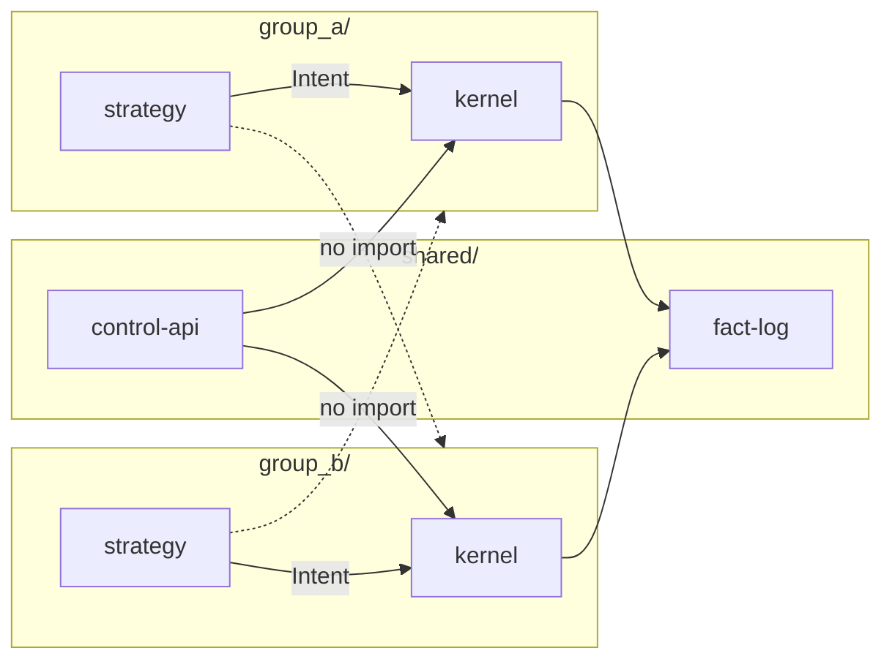

# SATE repository layout and separation of concerns

**Purpose:** Define how application code is organised in the **Sata** monorepo: two group domains (`group_a/`, `group_b/`), shared owner-facing services at `shared/`, and **path-scoped CI/CD** so a Group B deploy never rebuilds or restarts Group A (and vice versa), consistent with **A-IND-03**, **A-IND-04**, and **INV-03**.

**Authority:** Implements Group A **§1.3** (independence), **§2.6** (shared services), and [independent-deployment-strategy.md](./independent-deployment-strategy.md). Group B code lives in `group_b/` when that track starts; Group A design docs remain under `docs/design/group_a/`.

**Related:** [architecture-components.md](./architecture-components.md) (logical components → folders), [implementation-phases.md](./implementation-phases.md) Phase **1** (scaffold exit criteria).

---

## 1. Top-level repository shape

One git repository. **Two execution domains** plus **shared** surfaces. Documentation stays under `docs/`; runnable code under `group_a/`, `group_b/`, and `shared/`.

```
Sata/
  README.md
  docs/
    source/                    # normative Word specs (A, B, Telegram)
    design/
      group_a/                 # Group A engineering design (this package)
      group_b/                 # future Group B design package

  shared/                      # scope-aware; no broker trade credentials
    schemas/
    fact-log/
    capital/
    rcb/
    treasury/
    halt-coordinator/
    control-api/
    web/
    notifier-bot/
    market-data/
    monitoring/
    backup/
    cli-kill/
    ci/                        # path filters, deploy contracts, workflow docs

  group_a/                     # complete Group A domain — no imports from group_b/
    kernel/
    strategy/
    cognitive/
    broker/
    identity/
    infra/
    tests/

  group_b/                     # complete Group B domain — no imports from group_a/
    kernel/
    strategy/
    broker/
    identity/
    infra/
    tests/
```

**Rules:**

1. `group_a/` and `group_b/` **never import each other**. Shared code is imported only from `shared/` (and from within the same group tree).
2. **Trade credentials** exist only under `group_*/kernel/credentials/` (or equivalent vault module inside that group's kernel crate).
3. **Combined capital or RCB** may appear only in `shared/web` or reporting read APIs, labelled **reporting-only**; no kernel or sizing module may read a pooled field (**INV-03**).
4. `docs/` changes do **not** trigger application deploy workflows.

---

## 2. Separation of concerns (authority boundaries)

Each folder owns one class of authority. Violations (e.g. strategy calling MT5, web placing orders, bot holding Exness keys) are **defects**, not style issues.

### 2.1 Shared (`shared/`)

| Path | Concern | May | Must not |
|------|---------|-----|----------|
| `schemas/` | Wire contracts (Intent, Verdict, fact-log events) | Version schemas; require `group_scope` | Encode group-specific broker logic |
| `fact-log/` | Append-only audit chain | Persist and verify events | Approve trades or mutate risk |
| `capital/` | Five-state ledger **per scope** | Post capital events for `A` or `B` | Pool A+B for limits |
| `rcb/` | Ratification, cool-off **per scope** | Enforce §3.4 rules per group | Apply B RCB to A gate |
| `treasury/` | Cost tags A / B / GLOBAL; reimbursement | Allocate shared costs per rule | Move broker cash without events |
| `halt-coordinator/` | K1–K3, ALL-scope protocol | Partial ALL when B absent (**INV-06**) | Infer full ALL halt from unreachable B |
| `control-api/` | Auth, scope, arming/resume | Risk-increasing paths → passkey | Submit orders |
| `web/` | Owner SPA | Separate A and B views; combined reporting label | Security boundary for trading |
| `notifier-bot/` | Telegram reduce-only UX | Halt, kill, SIM, check-in | Resume, arm LIVE, loosen limits |
| `market-data/` | Freshness-tagged feeds | Publish to subscribers | Trade authority |
| `monitoring/` | Metrics, CRITICAL alerts | Route on-call | Suppress CRITICAL |
| `backup/` | Encrypted backup/restore | Verify hash chain on restore | Skip verification |
| `cli-kill/` | Signed out-of-band kill | Local channel to kernel | Broad network exposure |
| `ci/` | Pipeline definitions | Path-filtered deploy | Deploy all groups on every push |

### 2.2 Group A (`group_a/`)

| Path | Concern | Maps to design doc |
|------|---------|-------------------|
| `kernel/verdict/` | Ordered §6.4 checks → Verdict | [05-kernel-oms-reconciliation.md](./05-kernel-oms-reconciliation.md) |
| `kernel/credentials/` | Exness trade keys (**A-KRN-02**) | [05-kernel-oms-reconciliation.md](./05-kernel-oms-reconciliation.md), [06-broker-exness-mt5.md](./06-broker-exness-mt5.md) |
| `kernel/oms/` | Idempotency, lifecycle (**A-OMS-***) | [05-kernel-oms-reconciliation.md](./05-kernel-oms-reconciliation.md) |
| `kernel/reconcile/` | Broker source of truth (**A-REC-***) | [05-kernel-oms-reconciliation.md](./05-kernel-oms-reconciliation.md) |
| `kernel/constitution/` | Load, verify, pin signed artifact | [07-constitution-crypto-deployment.md](./07-constitution-crypto-deployment.md) |
| `strategy/signals/` | Kalman, regime, BL | [04-strategy-quant-engine.md](./04-strategy-quant-engine.md) |
| `strategy/sizing/` | Risk-budget sizing | [04-strategy-quant-engine.md](./04-strategy-quant-engine.md) |
| `strategy/journal/` | Pre-intent journal (**A-PR-08**) | [10-data-audit-fact-log.md](./10-data-audit-fact-log.md) |
| `cognitive/` | AdvisorySignal only | [09-cognitive-plane.md](./09-cognitive-plane.md) |
| `broker/mt5-bridge/` | Normalised broker I/O | [06-broker-exness-mt5.md](./06-broker-exness-mt5.md) |
| `broker/terminals/` | Demo/live portable installs (ops) | [06-broker-exness-mt5.md](./06-broker-exness-mt5.md) |
| `identity/` | A-SIM / A-LIVE registry (**A-P0-01**) | [01-system-overview-independence.md](./01-system-overview-independence.md), [15-persistent-schemas-constitution.md](./15-persistent-schemas-constitution.md) |
| `infra/` | Windows exec host, A DB, A deploy | [independent-deployment-strategy.md](./independent-deployment-strategy.md) |
| `tests/unit/` | Crate-level tests | §16.1 **UT** |
| `tests/scenarios/` | TS-, HL-, OC-, … harness | [13-scenarios-runbooks.md](./13-scenarios-runbooks.md) |

**Kernel internal split:** Prefer separate crates or modules for `verdict`, `credentials`, `oms`, and `reconcile` so linking strategy code into the credential vault is impossible at build time.

### 2.3 Group B (`group_b/`) — future

Same **shape** as Group A, different broker and strategy modules:

| Path | Concern |
|------|---------|
| `kernel/*` | KERNEL-B; Alpaca credentials only inside B kernel |
| `strategy/b-minimal/`, `strategy/b-full/` | Group B doc strategies |
| `broker/alpaca-adapter/` | Alpaca integration |
| `identity/`, `infra/`, `tests/` | B-scoped registry and deploy |

Until Group B is implemented, `group_b/` may contain a `README.md` placeholder only; CI must still define `deploy-group-b` with path filters so the contract exists before first B code.

---

## 3. Logical components → repository paths

| Logical component (§2.5) | Repository location |
|--------------------------|---------------------|
| KERNEL-A | `group_a/kernel/` |
| OMS, reconciliation | `group_a/kernel/oms/`, `group_a/kernel/reconcile/` |
| Strategy / quant | `group_a/strategy/` |
| Cognitive plane | `group_a/cognitive/` |
| MT5 bridge | `group_a/broker/mt5-bridge/` |
| Fact log | `shared/fact-log/` |
| Capital / RCB / treasury services | `shared/capital/`, `shared/rcb/`, `shared/treasury/` (scoped APIs) |
| Halt coordinator | `shared/halt-coordinator/` |
| control-api, web | `shared/control-api/`, `shared/web/` |
| notifier-bot | `shared/notifier-bot/` |
| Market data | `shared/market-data/` |
| Monitoring, backup | `shared/monitoring/`, `shared/backup/` |
| Signed kill CLI | `shared/cli-kill/` → IPC to `group_a/kernel/` |
| KERNEL-B (future) | `group_b/kernel/` |

Runtime placement (Windows vs private network) remains in [independent-deployment-strategy.md](./independent-deployment-strategy.md) §3; **source ownership** is defined here.

---

## 4. CI/CD and independent deploy

### 4.1 Workflows (minimum)

| Workflow | `paths` trigger (push to `main`) | Artifact | Deploy target |
|----------|----------------------------------|----------|---------------|
| `deploy-group-a` | `group_a/**`, workflow file | `group-a-<git-sha>` | A Windows exec + A-linked infra |
| `deploy-group-b` | `group_b/**`, workflow file | `group-b-<git-sha>` | B hosts (when exist) |
| `deploy-shared` | `shared/**`, workflow file | `shared-<git-sha>` | Control plane, fact log, bot, web |
| `ci-docs` (optional) | `docs/**` | none | none |
| `ci-verify` (optional) | repo-wide on PR | test reports | none |

**Independence requirement:** A commit touching **only** `group_b/**` must **not** run `deploy-group-a`. A commit touching **only** `group_a/**` must **not** run `deploy-group-b`.

### 4.2 Shared schema changes

When `shared/schemas/**` changes:

- Default: run **`deploy-shared`** only; groups pick up new schema on their **next** group deploy.
- If a breaking schema change requires coordinated rollout, use explicit version fields in events and document in ADR; do not force simultaneous A+B kernel restart unless safety requires it.

### 4.3 Phase 1 exit criteria (repo)

- Empty or stub packages exist at paths in §1.
- Three deploy workflows exist with path filters as in §4.1.
- Contract test: `group_a/strategy` crate **cannot** depend on `group_a/kernel/credentials` (Cargo/feature guard or lint).
- ADR recorded: this layout + independent deploy ([decision-log.md](./decision-log.md) may reference ADR id).

Workflow file location: `shared/ci/workflows/` (copied or referenced from `.github/workflows/` per platform convention).

---

## 5. Data and dependency rules



- **Intents** flow strategy → kernel → broker; **events** flow kernel → fact log.
- **control-api** talks to kernels via scoped RPC; never holds trade keys.
- **Databases:** prefer separate schemas or DB instances per group for capital/risk projections; shared DB only with strict `group_scope` column enforced in `shared/capital` service layer (**A-P0-03**).

---

## 6. Initial scaffold (Phase 1)

Create directories and minimal build files so CI is green:

1. `shared/schemas/` — JSON Schema or protobuf stubs for Intent, Verdict, base event envelope with `group_scope`.
2. `group_a/kernel/` — Rust workspace root; binary stub `kernel-a`.
3. `group_a/strategy/`, `group_a/broker/mt5-bridge/` — Python or Rust stubs with `pyproject.toml` / `Cargo.toml` as chosen.
4. `group_b/README.md` — "not implemented; path filters active."
5. `shared/ci/` — document path filters; add GitHub Actions (or equivalent) under `.github/workflows/` at repo root referencing §4.1.

Implementation phases **2+** place real code in the paths listed in §2.2; do not collapse concerns into a single `group_a/app/` directory.

---

## 7. Traceability

| Requirement / invariant | Enforced by layout |
|-------------------------|-------------------|
| **A-IND-03** | No cross-group imports |
| **A-IND-04** | Independent deploy pipelines |
| **A-PR-02**, **A-KRN-02** | Credentials only under `group_*/kernel/credentials/` |
| **A-IND-02**, **A-P0-16** | Scope in `shared/control-api/` |
| **INV-03** | No pooled sizing module in repo |
| **A-MOD-05** | Separate terminal paths under `group_a/broker/terminals/` |

See [traceability-matrix.md](./traceability-matrix.md) for phase mapping; Phase **1** backlog enables all paths above.
