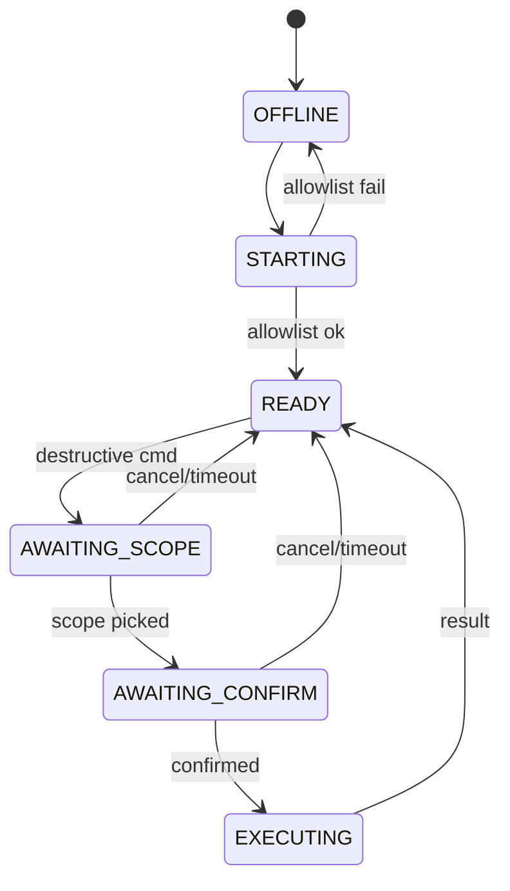

# Telegram interface (Group A integration)

**Authority:** [`docs/source/SATE_Telegram_Interface_Specification.docx`](../../source/SATE_Telegram_Interface_Specification.docx) v1.0 (2026-10-16). Subordinate to Group A system definition; implements **TG-**, **KIL-**, **HALT-**, **MOD-**, **CHK-**, **TRE-** families for both groups. Group A summary: §13.4 (**A-TG-01–06**).

**Process name:** `notifier-bot` (Python: python-telegram-bot or aiogram).

---

## 1. Design principles (§0)

1. **Reduce-only at the bot** — halt, flatten, kill, mode→SIM, cancel arming, check-in, read. No resume, SIM→LIVE, limit loosening (web + passkey only).
2. **Explicit scope** — every message/command tagged `[A-LIVE]`, `[A-SIM]`, `[B-*]`, `[ALL]`; confirm buttons name scope.
3. **Keyboard-first UX** — persistent reply keyboard + inline keyboards per flow.
4. **Every message → fact log** — message ID, principal, scope, category, severity, resulting event; replay/dedup.
5. **CRITICAL never suppressed** — flood control applies to INFO/NOTICE only.
6. **Bot is not authority** — bot token + **limited control token** only; no orders, Constitution, or broker credentials.

---

## 2. Scope (§1)

### 2.1 In scope

Keyboard layouts; notification taxonomy; status/positions/P&L/risk/controls/check-in flows; reduce-only controls; signed expiring confirm buttons; scope selection; formats/masking; allowlist/replay; bot state machine; integration with control-api and halt service.

### 2.2 Out of scope

Resume, SIM→LIVE, limit loosening, Constitution edit, broker credentials, direct orders.

### 2.3 Deferred

Emergency relay (**BLK-008**, **A-DEC-08**); distinct crypto authority for control token (**OI-TG-04**).

---

## 3. Message taxonomy (§2)

### 3.1 Severity

| Severity | Icon (Unicode) | Suppression |
|----------|----------------|-------------|
| INFO | U+1F535 blue circle | Batch/rate-limit; `/mute` |
| NOTICE | U+1F7E1 yellow circle | Batch/dedupe; `/mute` |
| WARN | U+1F7E0 orange circle | Always; not mutable |
| CRITICAL | U+1F534 red circle | Always; bypasses quiet hours |

Constitution `quiet_hours_utc` — CRITICAL still delivered.

### 3.2 Categories (16)

TRADE, WIN, LOSS, ABSTAIN, RISK, HALT, KILL, MODE, RECON, TREASURY, CHECK-IN, HEALTH, ERROR, SUMMARY, HEADS-UP, SYSTEM — each with default severity per spec §2.2.

### 3.3 Message format (§2.3)

```
[SCOPE] CATEGORY SEVERITY
Short line (≤200 chars)
Optional numeric second line
[Inline buttons]
```

Scope tags: `[A-LIVE]` `[A-SIM]` `[B-LIVE]` `[B-SIM]` `[ALL]`.

Group A trade example (§13.4):

```
[A-LIVE] TRADE INFO
BUY EURUSD 0.01 @ 1.0842 stop 1.0822
Why: Kalman + regime; advisory neutral.
Kernel: ALLOW (0.5% rcb_equity_A). /why 8f3a
```

---

## 4. Persistent reply keyboard (§3)

| Row | Col1 | Col2 | Col3 |
|-----|------|------|------|
| 1 | Status | Positions | P&L |
| 2 | Controls | Treasury | Help |

Buttons send predefined commands (`/status`, etc.). `ReplyKeyboardMarkup`: `resize_keyboard=true`, `is_persistent=true`; restore after restart (**TG-11**, TG-T-09).

---

## 5. Main menu flows (§4)

| Button | Command | Inline options |
|--------|---------|----------------|
| Status | `/status` | Group A, B, Both, Full report |
| Positions | `/positions` | A, B, Pending, Stops |
| P&L | `/pnl` | Today, Week, Month, Attribution, vs benchmark — **never sum A+B** |
| Controls | `/controls` | Halt, Flatten, Kill, Mode→SIM, Check-in, Away, Cancel arming |
| Treasury | `/treasury` | Cash floor, Obligations, Reimbursements, Withdrawals |
| Help | `/help` | Open web app |

**Group detail card** (scoped): mode, halt, kill, heartbeat, recon time, RCB, floor band — buttons `[Positions] [Risk] [Why] [Kill A]`.

Combined views: label **"Combined reporting — not transferable and not used for sizing or eligibility"** (**TG-14**, TG-T-13).

---

## 6. Scope selection and confirmation (§5)

Flow: **command → scope selection → confirmation** (destructive).

### 6.1 Halt (K1)

1. Controls → Halt.
2. Buttons: Group A, Group B, ALL, Cancel.
3. Confirm within **30s**: button e.g. `Confirm halt A` + Cancel.
4. Feedback: halt ID, `[A-LIVE] HALT WARN`, buttons Status + Resume (web link only).

### 6.2 Flatten (K2) / Kill (K3)

- Flatten: same flow; message includes position count; `Confirm flatten A`.
- Kill: scope → first confirm (30s) → **second** confirm `Confirm KILL A — revokes credentials` (60s). **Only two-step flow** (**TG-03**, TG-T-05).

### 6.3 Mode to SIM (§5.3)

Warn LIVE→MANAGE_ONLY; buttons `Switch A to SIM`, `Switch A + Flatten`, Cancel.

### 6.4 Check-in (§5.4)

`/alive` resets timer; next reminder date; not strong identity (**A-CHK-01**).

### 6.5 Away mode (§5.5)

Duration buttons (7/14/21/30 up to Constitution max — **OI-TG-02**); then **web passkey link** to complete (**TG-S-20**).

---

## 7. Notification catalogue (§6) — Group A focus

Implement template per event; classifier maps fact-log events → category/severity.

| § | Group A examples |
|---|------------------|
| 6.1 Trade | Order placed/filled/partial/cancelled; kernel reject; size reduced |
| 6.2 Win/Loss | Closed P&L vs RCB; daily summary |
| 6.3 Abstain | Skipped instrument (digest); tool abort |
| 6.4 Risk | Floor +10% WARN (**OI-TG-06**); floor cross; drawdown; margin |
| 6.5 Halt | L1–L4 transitions |
| 6.6 Kill | K1–K3 invoked/complete; partial ALL halt |
| 6.7 Mode | Arming, OTP issued (**TG-16**), LIVE-L1 ramp, reverse graduation |
| 6.8 Recon | Daily clean; mismatch CRITICAL → L2 |
| 6.9 Treasury | Payout due; reimbursement; missed deadline |
| 6.10 Check-in | Day 7/10/14 |
| 6.11 Health | Feed latency; kernel heartbeat; key expiry; backup fail |
| 6.12 Error | Broker reject; tool fail; kernel exception; fact-log write fail |
| 6.13 Summary | Daily 16:30 NY; weekly; `/digest` |
| 6.14 Heads-up | News blackout; regime; FOMC |

Illustrative amounts/times in source — not binding.

---

## 8. Commands (§7)

| Command | Class | Effect |
|---------|-------|--------|
| `/status`, `/positions`, `/pnl`, `/risk`, `/health`, `/digest` | read | Scoped reads |
| `/why <id>` | read | Fact-log-only explanation; numeric links (**TG-12**) |
| `/controls`, `/treasury`, `/help` | read | Open menus |
| `/alive` | neutral | Check-in |
| `/mute <duration>` | neutral | INFO/NOTICE only |
| `/mask on\|off` | neutral | Amount privacy |
| `/halt`, `/flatten`, `/kill` [A\|B\|ALL] | reduce | K1/K2/K3 flows |
| `/mode A sim`, `/mode A cancel` | reduce | SIM switch / cancel arming |

**Non-existent commands:** `/resume`, `/live`, `/loosen`, `/constitution`, `/edit` → ABSTAIN INFO + web link (**TG-09**, TG-T-07).

**SIM→LIVE OTP:** delivered via Telegram MODE WARN; entered **only in web** — bot has no LIVE confirm (**TG-16**, **OI-TG-01**).

---

## 9. Inline keyboard patterns (§8)

Menu navigation (≤3/row); confirmation (scope in label + Cancel); scope selection (A/B/ALL/Cancel); multi-choice (away durations + Cancel).

**Rule:** no destructive action without confirm step; every keyboard has Cancel.

Signed payload on confirm buttons (**TG-04**, SEC-03).

---

## 10. Message security (§9)

| ID | Requirement |
|----|-------------|
| SEC-01 | Single chat ID + single user ID allowlist; else discard + `auth.failed` |
| SEC-02 | Replay: store last N `update_id`s |
| SEC-03 | Confirm expiry 30s (K1/K2), 60s (K3 second) |
| SEC-04 | No secrets; mask accounts …1234; `/mask` for amounts |
| SEC-05 | Bot token encrypted in vault; rotate via BotFather; compromised token cannot increase exposure |
| SEC-06 | Log every command to fact log |
| SEC-07 | Telegram retains history — OTP single-use short-lived |

Align with **TG-05**, **TG-06**, **TG-08**, **TG-10**.

---

## 11. Bot state machine (§10)

| State | Timeout | Notes |
|-------|---------|-------|
| OFFLINE → STARTING → READY | — | Failed allowlist → DISCARD |
| AWAITING_SCOPE | 60s | Destructive without scope |
| AWAITING_CONFIRM | 30s (60s K3 #2) | |
| EXECUTING → READY | — | |

Expiry → READY; discard pending command (**TG-S-17**, TG-T-03).



---

## 12. Requirements TG-01–TG-16 (§11)

Full text in source spec §11 — implementation checklist:

- TG-01 scope+category+severity on proactive messages
- TG-02 scope in destructive confirms
- TG-03 K3 double confirm
- TG-04 signed expiring confirms
- TG-05 allowlist
- TG-06 replay protection
- TG-07 CRITICAL not suppressible
- TG-08 no credentials in messages
- TG-09 no exposure-increasing commands
- TG-10 command logging
- TG-11 persistent reply keyboard
- TG-12 /why fact-linked numbers
- TG-13 batch INFO/NOTICE (**OI-TG-05** threshold)
- TG-14 combined label
- TG-15 partial halt display
- TG-16 OTP via TG, confirm in web

---

## 13. Scenarios TG-S-01–TG-S-25 (§12)

Map each to integration tests — see source table. Group A-critical: TG-S-01–06 (trade/halt/recon), TG-S-08–10 (kill), TG-S-11–14 (check-in), TG-S-15–16 (takeover/partial halt), TG-S-21–22 (treasury/floor), TG-S-25 (/why).

Cross-ref Group A scenarios: [13-scenarios-runbooks.md](./13-scenarios-runbooks.md).

---

## 14. Integration architecture (§13)

### 14.1 Process boundaries

```
notifier-bot
  credentials: bot token + limited control token ONLY
  cannot: reach kernels directly, place orders, edit Constitution

control-api
  validates scope, forwards halt/kill/mode

halt coordinator + KERNEL-A/B
```

### 14.2 Notification pipeline

```
fact-log stream → classifier → template renderer → rate limiter/batcher (INFO/NOTICE)
  → Telegram sendMessage → fact log (message_id)
```

### 14.3 Control pipeline

```
Telegram update → allowlist → replay → parser → scope/confirm
  → control-api (limited token) → kernel/mode service → result → TG message + fact log
```

**A-KIL-02** / **A-TG-06**: resume/LIVE only via web.

Integration with Group A halt states: [08-halts-kill-checkin.md](./08-halts-kill-checkin.md).

---

## 15. Tests TG-T-01–TG-T-15 (§14)

| ID | Pass condition |
|----|----------------|
| TG-T-01 | Non-allowlisted → discard + auth.failed |
| TG-T-02 | Replay update_id rejected |
| TG-T-03 | Expired confirm errors + reset |
| TG-T-04 | Confirm labels contain scope |
| TG-T-05 | K3 needs two presses |
| TG-T-06 | CRITICAL during /mute delivered |
| TG-T-07 | /resume /live → web link only |
| TG-T-08 | Partial halt never HALT_CONFIRMED_ALL |
| TG-T-09 | Keyboard after restart |
| TG-T-10 | Template scan: no secrets |
| TG-T-11 | 20 INFO/60s → batched |
| TG-T-12 | /why numbers have fact refs |
| TG-T-13 | Combined values labelled |
| TG-T-14 | Hijacked bot cannot increase exposure |
| TG-T-15 | A/B/ALL halt flows independent |

Included in Group A §16.1 **TG** class.

---

## 16. Implementation backlog TG-PO-01–15 (§15)

| ID | Task | Deps | Pri |
|----|------|------|-----|
| TG-PO-01 | Skeleton: allowlist, replay, logging | control-api, fact log | P0 |
| TG-PO-02 | Reply keyboard persist | TG-PO-01 | P0 |
| TG-PO-03 | Classifier + templates | TG-PO-01 | P0 |
| TG-PO-04 | Rate limit/batch INFO/NOTICE | TG-PO-03 | P0 |
| TG-PO-05 | Signed confirm buttons | TG-PO-01, crypto | P0 |
| TG-PO-06 | Scope flows halt/flatten/kill/SIM | TG-PO-05 | P0 |
| TG-PO-07 | K3 double confirm | TG-PO-05 | P0 |
| TG-PO-08 | /alive, away → web auth | TG-PO-05, web | P0 |
| TG-PO-09 | control-api integration | Control API | P0 |
| TG-PO-10 | Fact-log event subscription | Fact log | P0 |
| TG-PO-11 | /why fact-sourced | Fact log, reasoner | P1 |
| TG-PO-12 | /digest | TG-PO-03 | P1 |
| TG-PO-13 | /mute + CRITICAL bypass | TG-PO-04 | P1 |
| TG-PO-14 | Treasury templates | Treasury | P1 |
| TG-PO-15 | Health/error templates | Monitoring | P1 |

Phase mapping: [implementation-phases.md](./implementation-phases.md) **Phase 18** (core bot), **25–27** (P1 features).

---

## 17. Definition of Done (§16)

12 criteria — allowlist/replay; destructive confirms; reduce-only verified; CRITICAL bypass; no credentials; batching; partial halts; /why links; keyboard persist; command logging; no trade credentials/direct kernel; all §6 categories tested.

---

## 18. Open items (§18)

| ID | Item |
|----|------|
| OI-TG-01 | SIM→LIVE code delivery vs web entry |
| OI-TG-02 | Away max duration |
| OI-TG-03 | Emergency relay (A-DEC-08) |
| OI-TG-04 | Control token crypto authority |
| OI-TG-05 | Batching threshold / no_batch list |
| OI-TG-06 | Floor warning = WARN (confirmed) |

Tracked in [decision-log.md](./decision-log.md).
